# EVIDENCIAS

Creo el contenedor

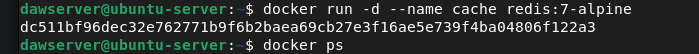

el contenedor temporal intenta conectarse a cache por su nombre, 
pero falla porque la red por defecto de 
Docker (bridge) no proporciona resolución DNS entre contenedores

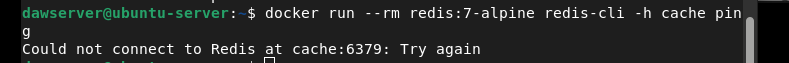

El comando ping se utiliza para verificar la conectividad de red y el estado de salud del servicio. 
Al recibir la respuesta PONG, tenemos la confirmación empírica de que el contenedor responde 
y que la comunicación directa a través de la IP en la red bridge funciona correctamente, 
compensando la falta de resolución DNS.

---

***A partir de aqu'i hice el ejercicio en local desde casa con Windows 11***

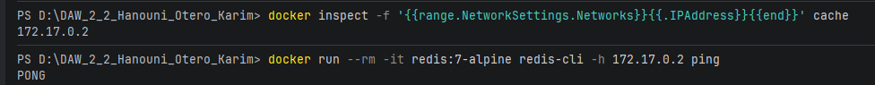

Creo la red personalizada y conecto el contenedor

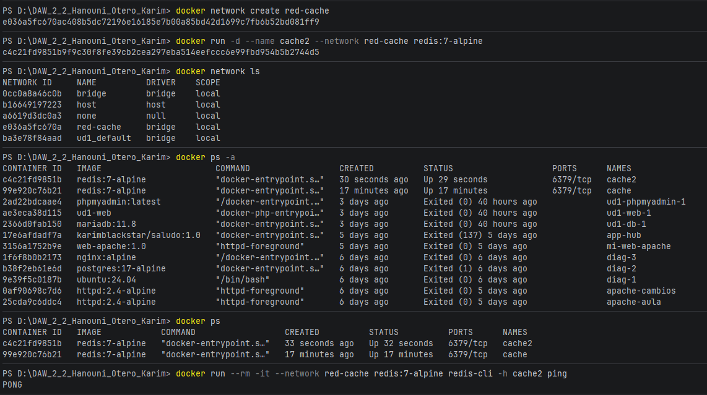

El valor se encuentra almacenado en la memoria RAM asignada al contenedor cache2 
y en su capa efímera de lectura y escritura.

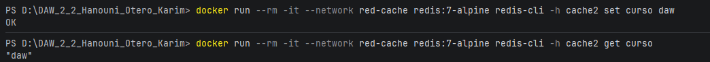

**Explica por qué en la configuración de una aplicación se usan nombres de contenedor y no
direcciones IP, y por qué para todo esto no ha hecho falta publicar ningún puerto.**

En las configuraciones de aplicaciones se utilizan los nombres de los contenedores 
porque sus direcciones IP son dinámicas y cambian cada vez que se reinician o se vuelven a crear, 
mientras que el nombre permanece estático. No es necesario publicar puertos (usando -p) \
porque todos los contenedores que comparten la misma red interna de Docker 
tienen acceso a todos sus puertos recíprocamente de forma predeterminada.

Al destruir los contenedores sin haber configurado previamente volúmenes persistentes, 
todos los datos almacenados en ellos se pierden de forma permanente.

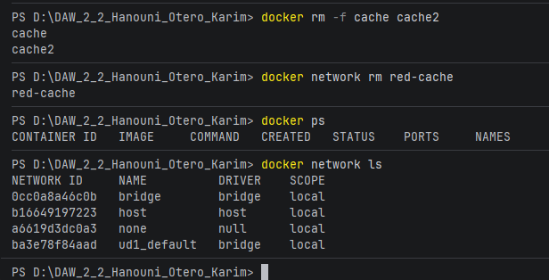

Creo ambas redes 

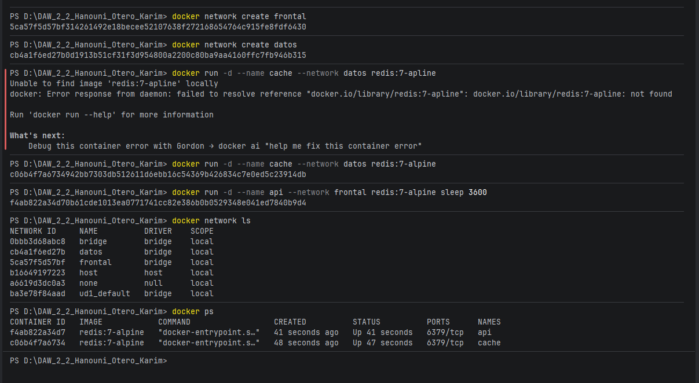

No estan conectadas

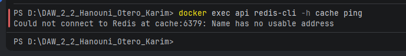

Una vex conectadas recibimos la respuesta de confirmacion 

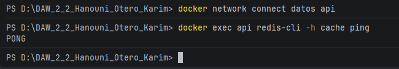

Y con un contenedor temporal no devuelve  PONG

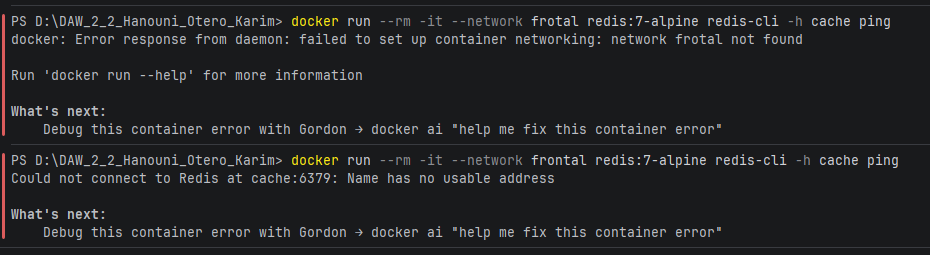 

Esta arquitectura de redes segmentadas garantiza que la base de datos (cache) permanezca oculta e inaccesible desde el exterior. 
Si un atacante logra comprometer un contenedor expuesto al público en la red frontal (como un servidor web), 
no podrá saltar directamente a la base de datos porque físicamente no hay ruta de red hacia ella. 
Solo los servicios explícitamente autorizados (como api, conectado a ambas redes) actúan como puente seguro.

Creamos una red, su volumen y la lanzamos

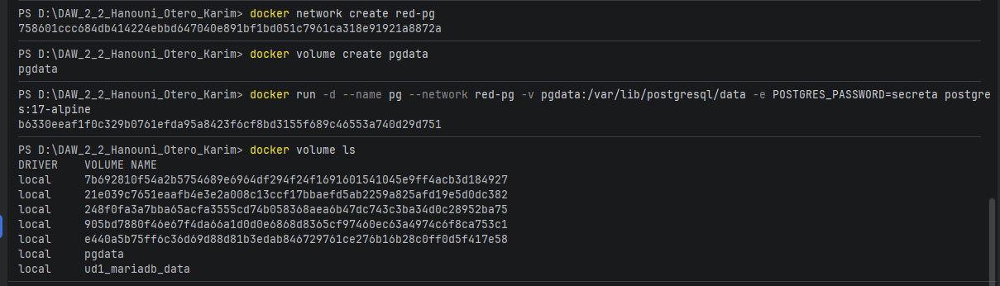

creamos la base de datos

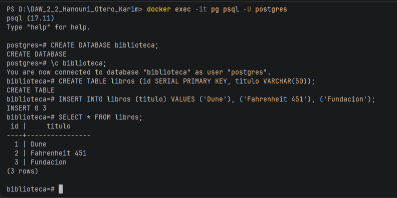

Borramos el contenedor pero luego mostramos el volumen de ese contenedor

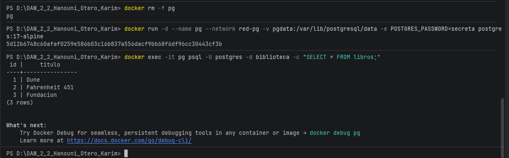

Nos conectamos a la red mediante un contenedor temporal

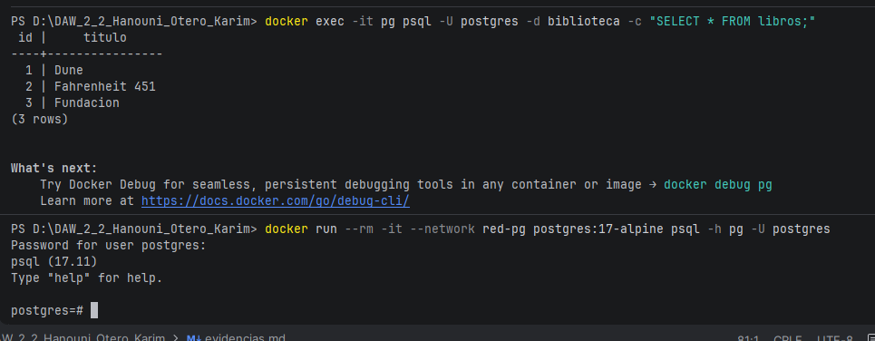

Al usar el flag -v pgdata:/var/lib/postgresql/data, le indicamos a Docker que guarde todo lo que la base de datos 
escriba en esa carpeta interna directamente en un volumen gestionado en el disco del servidor anfitrión. 
Cuando se elimina el contenedor, Docker destruye su capa efímera, pero el volumen pgdata queda intacto. 
Al arrancar un contenedor nuevo y engancharle el mismo volumen, 
el nuevo motor de base de datos lee los archivos persistidos y recupera toda la información sin perder nada.

Esta actividad 1.4 la he realizado en mi equipo local con Docker Desktop sobre Windows, 
por lo que he publicado el puerto 80 para poder testear la conectividad desde el anfitrión."

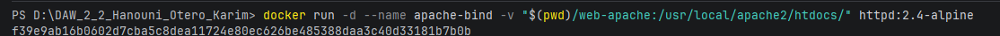

Tuve que hacert unos arreglos por temas de Windows

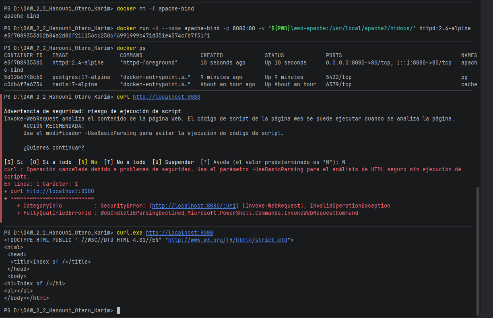

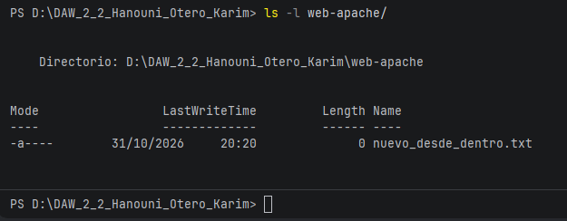

He realizado este ejercicio localmente en Windows con Docker Desktop. 
Al crear el archivo desde dentro del contenedor (usuario root), el bind mount lo refleja en mi carpeta local. 
Sin embargo, el comando ls (o Get-ChildItem en PowerShell) de Windows no muestra a 'root' como propietario, 
ya que Docker Desktop gestiona y traduce los permisos entre el sistema de archivos de Linux 
y el de Windows para permitir la edición. Si esto se ejecutara nativamente en Linux, 
el archivo pertenecería a root y requeriría privilegios para ser modificado por el usuario del anfitrión.