# EVIDENCIAS PRÁCTICAS DOCKER

## 1. Gestión de Redes Básica y DNS
Creo el contenedor inicial:

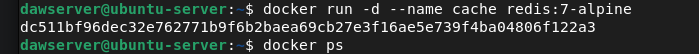

El contenedor temporal intenta conectarse a `cache` por su nombre, pero falla porque la red por defecto de Docker (`bridge`) no proporciona resolución DNS entre contenedores:

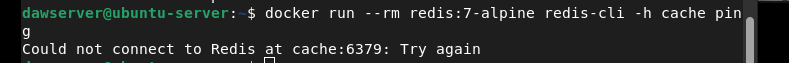

> **Nota sobre el comando ping:** Se utiliza para verificar la conectividad de red y el estado de salud del servicio. Al recibir la respuesta `PONG`, tenemos la confirmación empírica de que el contenedor responde y que la comunicación directa a través de la IP en la red `bridge` funciona correctamente, compensando la falta de resolución DNS.

---

*A partir de aquí, el ejercicio se realizó en entorno local utilizando Windows 11.*

## 2. Redes Personalizadas y Aislamiento
Creo la red personalizada y conecto el contenedor:

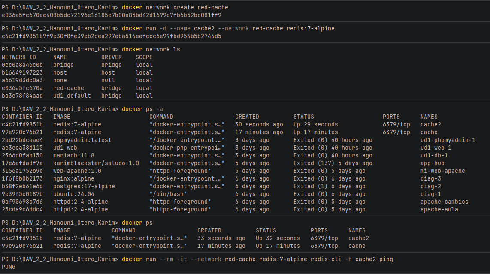

El valor se encuentra almacenado en la memoria RAM asignada al contenedor `cache2` y en su capa efímera de lectura y escritura:

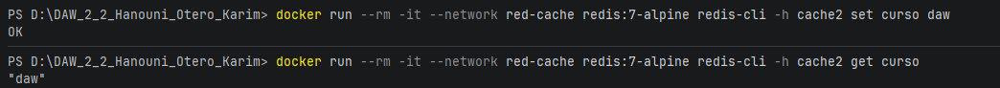

> **¿Por qué en la configuración de una aplicación se usan nombres de contenedor y no direcciones IP, y por qué para todo esto no ha hecho falta publicar ningún puerto?**
> En las configuraciones de aplicaciones se utilizan los nombres de los contenedores porque sus direcciones IP son dinámicas y cambian cada vez que se reinician o se vuelven a crear, mientras que el nombre permanece estático. No es necesario publicar puertos (usando `-p`) porque todos los contenedores que comparten la misma red interna de Docker tienen acceso a todos sus puertos recíprocamente de forma predeterminada.

Al destruir los contenedores sin haber configurado previamente volúmenes persistentes, todos los datos almacenados en ellos se pierden de forma permanente:

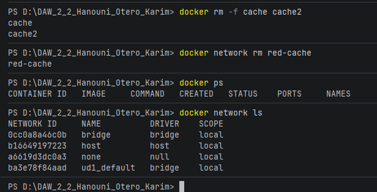

### Segmentación de Redes
Creo ambas redes:

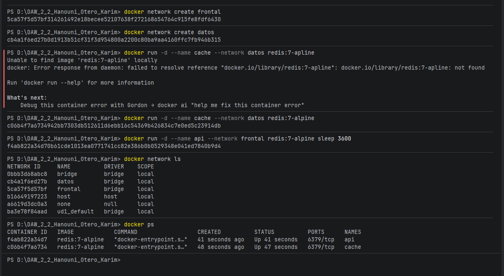

Inicialmente, no están conectadas:

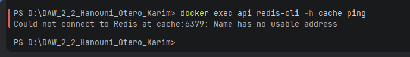

Una vez conectadas, recibimos la respuesta de confirmación:

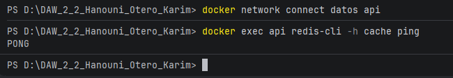

Y con un contenedor temporal comprobamos que no devuelve `PONG` si no está en la red correcta:

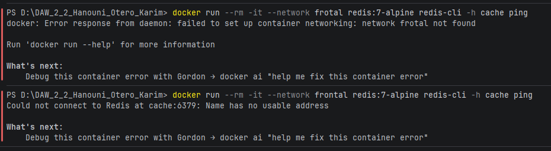

**Conclusión sobre Arquitectura de Red:**
Esta arquitectura de redes segmentadas garantiza que la base de datos (cache) permanezca oculta e inaccesible desde el exterior. Si un atacante logra comprometer un contenedor expuesto al público en la red frontal (como un servidor web), no podrá saltar directamente a la base de datos porque físicamente no hay ruta de red hacia ella. Solo los servicios explícitamente autorizados (como la API, conectada a ambas redes) actúan como puente seguro.

---

## 3. Gestión de Volúmenes y Persistencia de Datos
Creamos una red, su volumen asociado y levantamos el entorno:

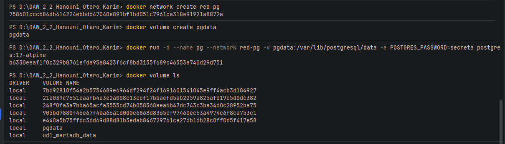

Creamos la base de datos:

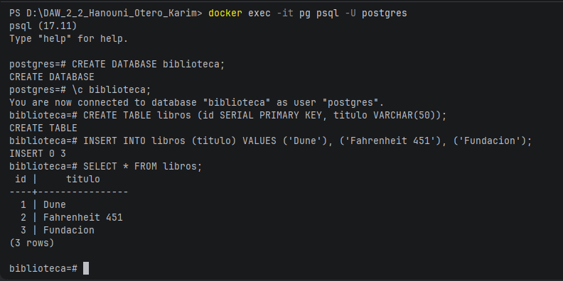

Borramos el contenedor, pero luego mostramos el volumen persistente de ese contenedor:

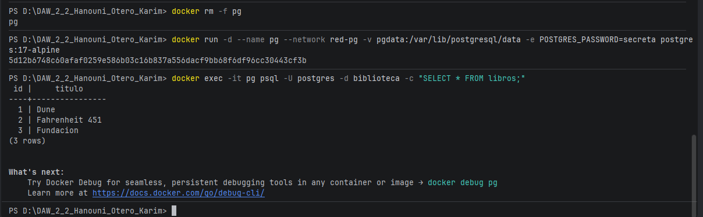

Nos conectamos a la red mediante un contenedor temporal para verificar la persistencia:

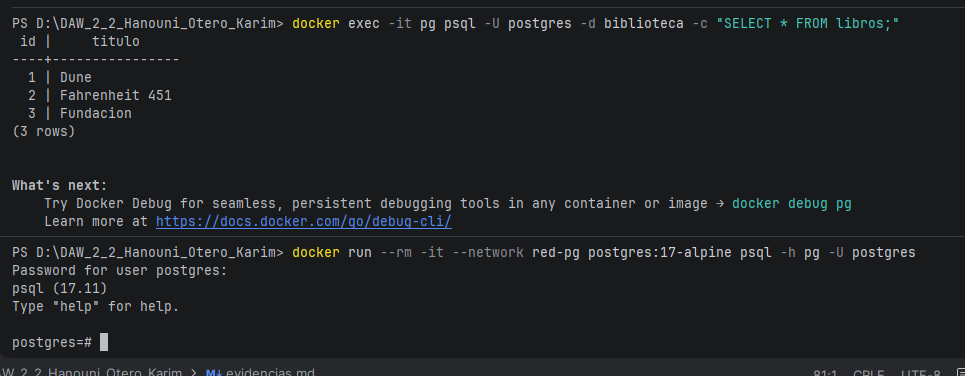

> **Funcionamiento de los Volúmenes:** Al usar el flag `-v pgdata:/var/lib/postgresql/data`, le indicamos a Docker que guarde todo lo que la base de datos escriba en esa carpeta interna directamente en un volumen gestionado en el disco del servidor anfitrión. Cuando se elimina el contenedor, Docker destruye su capa efímera, pero el volumen `pgdata` queda intacto. Al arrancar un contenedor nuevo y engancharle el mismo volumen, el nuevo motor de base de datos lee los archivos persistidos y recupera toda la información sin perder nada.

*(Nota: Esta actividad 1.4 la he realizado en mi equipo local con Docker Desktop sobre Windows, por lo que he publicado el puerto 80 para poder testear la conectividad desde el anfitrión).*

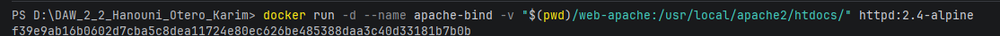

### Resolución de Permisos en Entorno Windows (Bind Mounts)
Tuve que hacer unos arreglos por temas de compatibilidad en Windows:

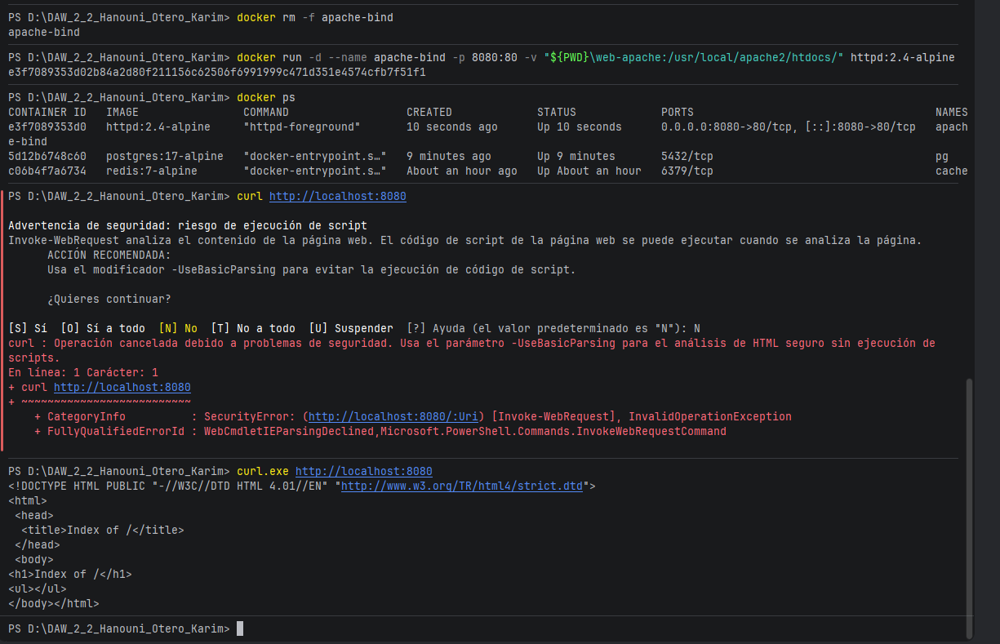
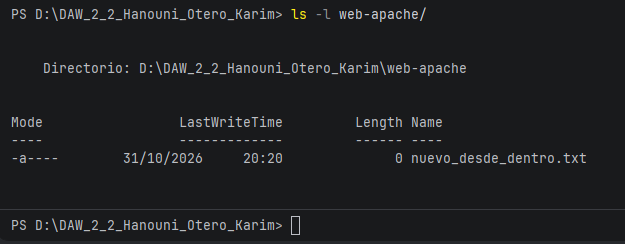

**Explicación técnica:** He realizado este ejercicio localmente en Windows con Docker Desktop. Al crear el archivo desde dentro del contenedor (usuario root), el bind mount lo refleja en mi carpeta local. Sin embargo, el comando `ls` (o `Get-ChildItem` en PowerShell) de Windows no muestra a 'root' como propietario, ya que Docker Desktop gestiona y traduce los permisos entre el sistema de archivos de Linux y el de Windows para permitir la edición. Si esto se ejecutara nativamente en Linux, el archivo pertenecería a root y requeriría privilegios para ser modificado por el usuario del anfitrión.

---

## 4. Docker Compose: WordPress y MariaDB

Creo los archivos `.env` y `compose.yaml`, y levanto los contenedores:

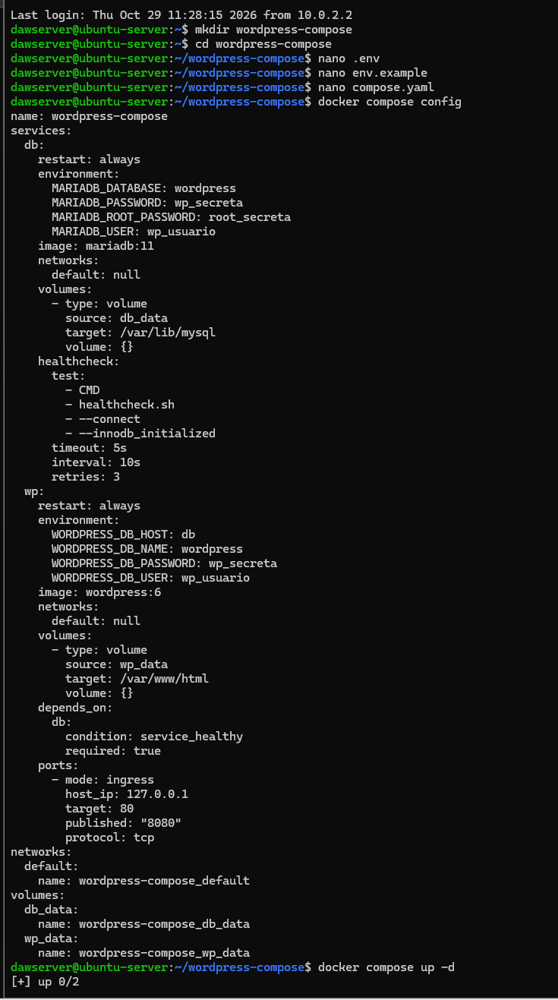
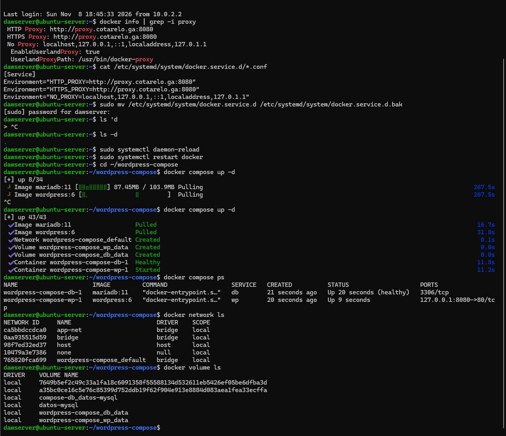

Instalo WordPress a través del navegador:

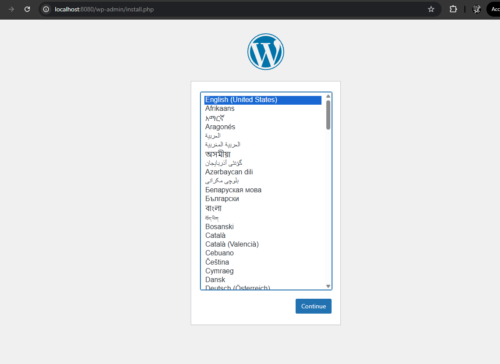
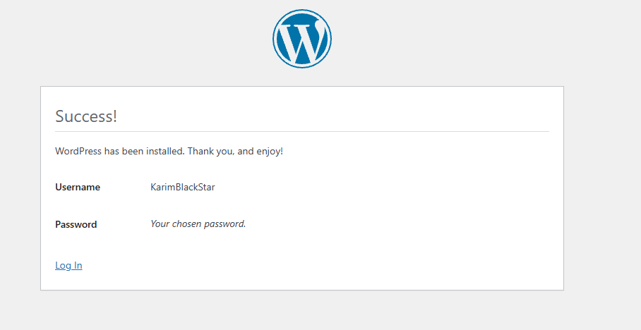
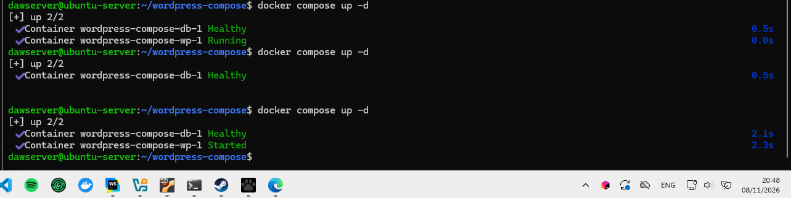

> **Comportamiento Declarativo:** Al ejecutar `docker compose up -d` sin modificar nada, Compose compara el estado actual con el archivo `compose.yaml` y, al ser idénticos, no hace nada (0.0s). Al añadir la etiqueta `labels` al servicio `wp`, Compose detecta el cambio en la configuración y, de forma inteligente, destruye y recrea únicamente el contenedor afectado (`wp`), dejando intacta la base de datos (`db`).

Elimino el contenedor de WordPress:

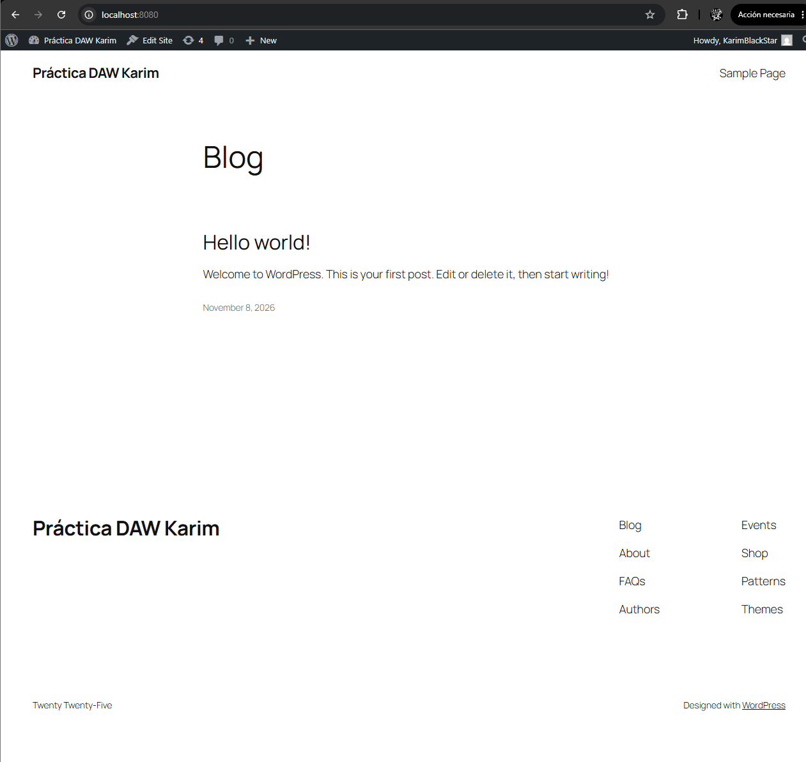

**Persistencia en Compose:** Al eliminar el contenedor `wp` y volver a recrearlo con `docker compose up -d`, la entrada del blog se conserva intacta. Esto ocurre porque los datos no se guardan dentro del ciclo de vida efímero del contenedor, sino que persisten gracias a que los archivos web y la base de datos están almacenados en los volúmenes nombrados (`wp_data` y `db_data`) que declaramos en el `compose.yaml`.

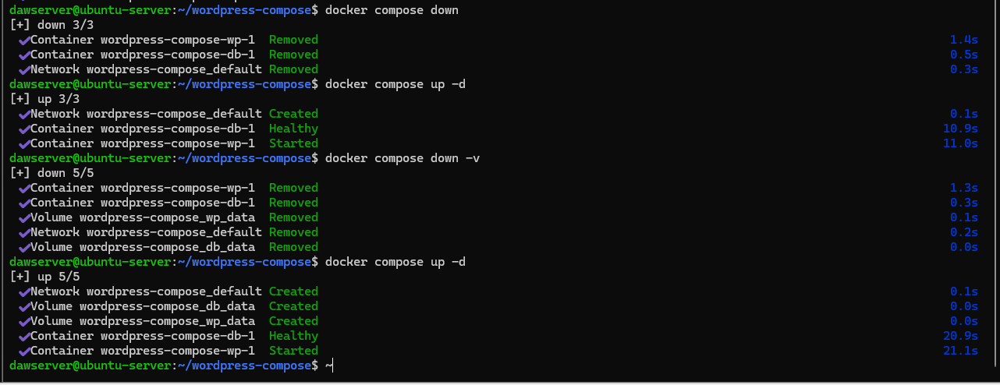
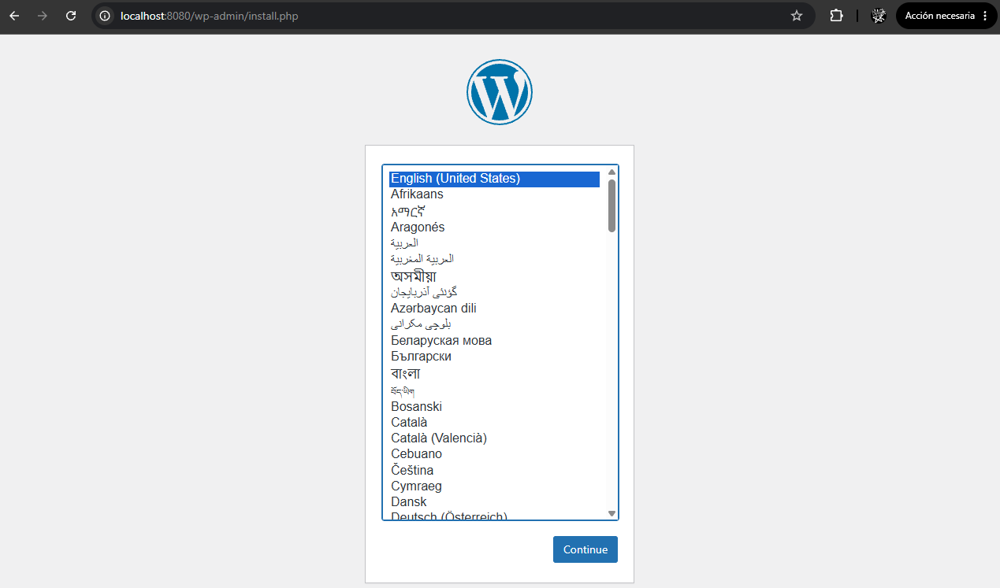

**Destrucción de Volúmenes (-v):** El comando `docker compose down` detiene y elimina los contenedores y la red, pero por seguridad conserva intactos los volúmenes nombrados, permitiendo que la entrada sobreviva al volver a levantar el proyecto. Sin embargo, al añadir la bandera `-v` (`docker compose down -v`), ordenamos a Compose destruir también los volúmenes asociados. Esto elimina físicamente los datos de la base de datos y los archivos web, provocando que al hacer `up -d` nuevamente, WordPress nos reciba con el asistente de instalación limpia porque ha perdido toda su información.

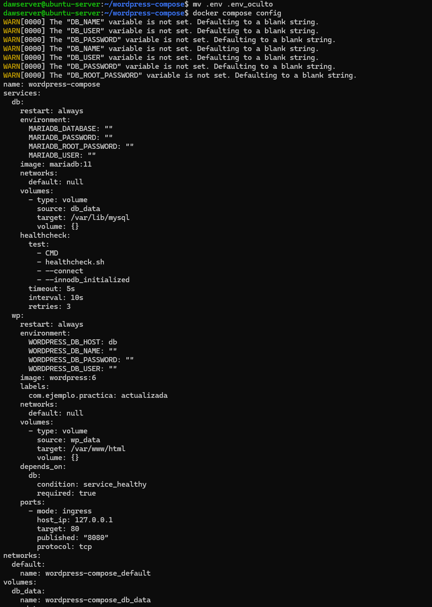
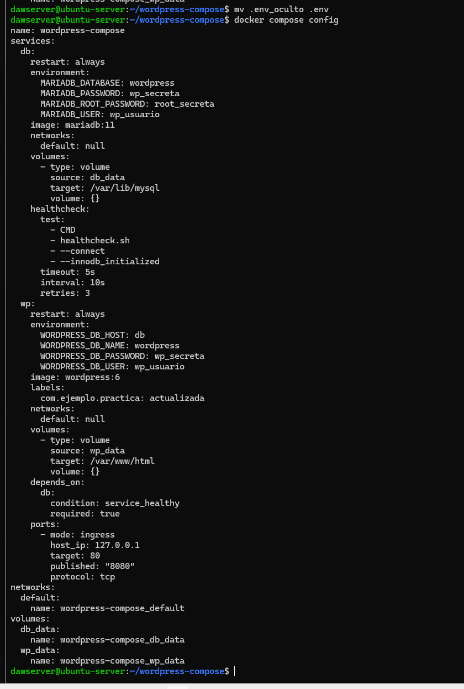

**Validación sin archivo .env:** Al renombrar el archivo `.env`, Docker Compose pierde el acceso a las variables de entorno que definimos para las contraseñas y usuarios. Cuando ejecutamos `docker compose config` para validar el proyecto, el orquestador detecta que en el `compose.yaml` se están llamando a variables (como `${DB_USER}`) que no tienen ningún valor asignado en el sistema, lanzando advertencias de que esas variables están vacías o no configuradas. Esto demuestra la importancia del archivo `.env` para inyectar datos sensibles sin escribirlos directamente en el código.

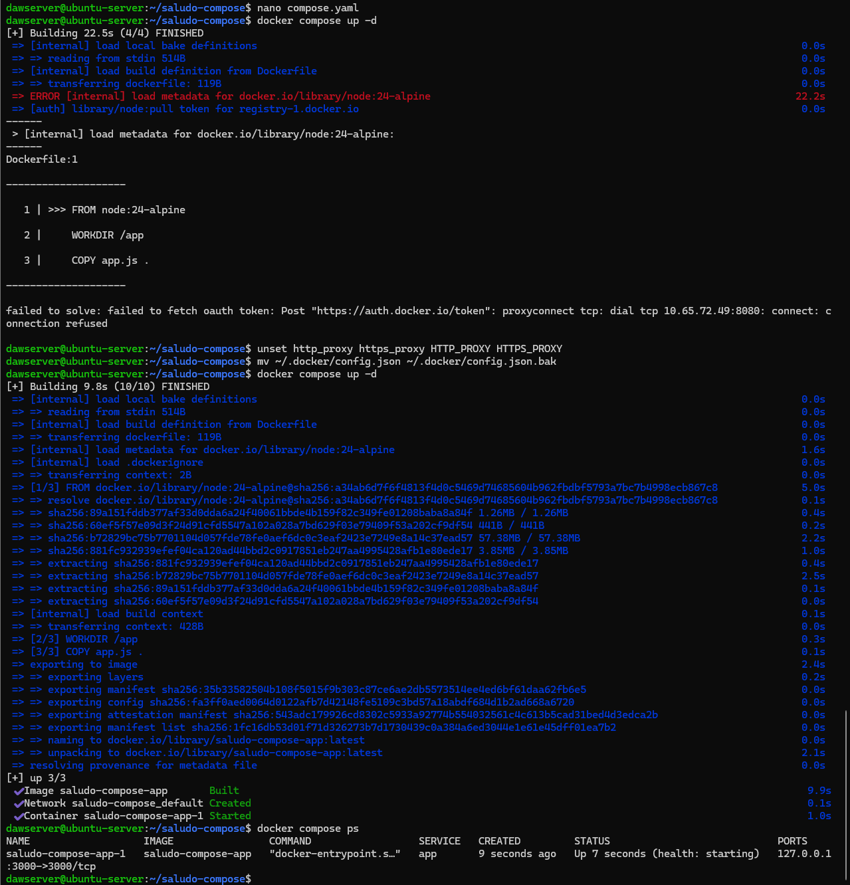
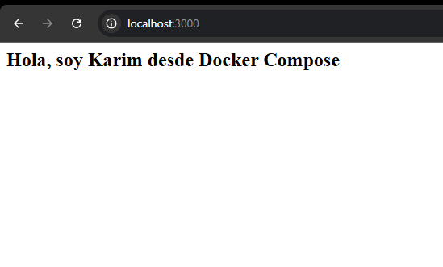